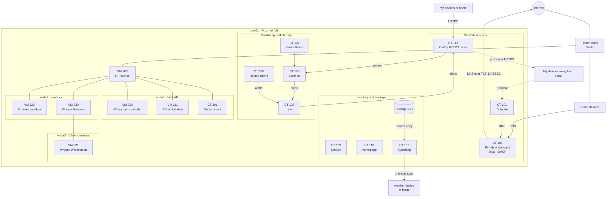

# Proxmox Homelab

One Proxmox VE server that runs my home network: filtered, encrypted DNS for every
device, remote access over Tailscale, monitoring with alerts to my devices, an IP
inventory, and nightly backups that leave the server. It also hosts lab networks
behind OPNsense: an Active Directory domain, a disposable browser sandbox and Tor
browsing with Whonix.

**The problem it solves:** one DNS resolver for the whole house that filters ads and
sends its queries out encrypted, the home network reachable from anywhere
without opening a single port, knowing what broke and where without guessing, and
being able to rebuild any service from last night's backup.

**What I learned building it:**

- A fix that works does not prove the explanation. A DNS failure first blamed on QNAME
  minimization turned out to be the ISP answering every plain DNS query
  ([TSH-02](troubleshooting/02-recursive-dns-nxdomain.md),
  [TSH-04](troubleshooting/04-isp-intercepted-dns.md)).
- An alert is real only once it has reached me. The disk-health alert had never
  worked until a failing SSD showed it ([TSH-03](troubleshooting/03-failing-system-ssd.md)).
- A backup counts once it has been restored and started, not when the job reports
  success ([Backups](docs/07-backups.md)).

> **A snapshot, not a live map.** This repository documents how the home lab was
> designed and built. Identifying details are left out or generalized, and the network
> keeps changing after publication, so addresses, names and versions here may no
> longer match what runs at home.

Everything described here was built and running when it was written. Each page explains what a service does, how
it is built, why it is built that way, and how to verify it.

## Services

| ID | Name | Software | Role | Docs |
|---|---|---|---|---|
| — | `pve01` | Proxmox VE 9 | The hypervisor: a small desktop with 4 cores, 32 GB of RAM and two SSDs | [Node and storage](docs/01-node-and-storage.md) |
| CT 100 | `pihole-dns` | Pi-hole, Unbound | DNS and DHCP for the whole network: blocklist, local `.lan` names, DNSSEC, encrypted upstream (DNS over TLS) | [DNS](docs/02-dns.md) |
| CT 101 | `tailscale-vpn` | Tailscale | Subnet router and exit node | [Remote access](docs/03-remote-access.md) |
| CT 105 | `uptime-kuma` | Uptime Kuma, rsyslog | Probes for each network segment, status page, router syslog | [Monitoring](docs/04-monitoring.md) |
| CT 107 | `prometheus` | Prometheus, prometheus-pve-exporter | 30 days of node and container metrics | [Monitoring](docs/04-monitoring.md) |
| CT 108 | `grafana` | Grafana | Dashboards and alert rules | [Monitoring](docs/04-monitoring.md) |
| CT 106 | `ntfy` | ntfy | Self-hosted push notifications to my devices | [Alerting](docs/05-alerting.md) |
| CT 109 | `netbox` | NetBox | IP address and device inventory | [Inventory and dashboard](docs/06-inventory-and-dashboard.md) |
| CT 110 | `homepage` | Homepage | Start page with the live status of every service | [Inventory and dashboard](docs/06-inventory-and-dashboard.md) |
| CT 112 | `caddy-proxy` | Caddy | HTTPS in front of the panels (Syncthing serves its own), with its own certificate authority | [Firewall](docs/10-firewall.md#https-for-the-panels) |
| CT 102 | `syncthing` | Syncthing | Ships the newest backups to another device at home every night | [Backups](docs/07-backups.md) |
| VM 200 | `opnsense-lab` | OPNsense | Firewall and router of the lab networks | [Labs](docs/09-labs.md) |
| CT 201 | `debian-13-client` | Debian 13 | Test client behind OPNsense | [Labs](docs/09-labs.md) |
| VM 210 | `windows-server-2025-dc` | Windows Server 2025 | Domain controller of `ad.lab` | [Labs](docs/09-labs.md) |
| VM 211 | `windows-11-client` | Windows 11 Enterprise | Workstation `WS01`, joined to `ad.lab` and managed by Group Policy | [Labs](docs/09-labs.md) |
| VM 220 | `browser-sandbox` | Debian live | Diskless browser for untrusted sites, DNS pinned to Pi-hole | [Browser sandbox](docs/11-browser-sandbox.md) |
| VM 230 | `whonix-gateway` | Whonix 18 | Tor gateway between the sandbox and the Whonix network | [Tor isolation](docs/12-tor-isolation.md) |
| VM 231 | `whonix-workstation` | Whonix 18 | Tor Browser, with no route except the gateway | [Tor isolation](docs/12-tor-isolation.md) |

Patching and firewall for all of them: [Patching](docs/08-patching.md) and
[Firewall](docs/10-firewall.md). The other containers on the node belong to other
projects and are out of scope here.

## How it is built

- **One service per unprivileged LXC container**, Debian 13. Virtual machines only
  where a different kernel or full isolation is needed: OPNsense (FreeBSD), Windows
  Server and Windows 11, and the machines that open untrusted websites.
- **Addresses follow the container ID:** CT 1*xx* lives at `<lan>.1xx`, so CT 100 is
  `.100` and CT 110 is `.110`. Every service also has a `.lan` name served by Pi-hole.
- **Nothing is exposed to the internet.** There are no port forwards; remote access
  goes only through Tailscale.
- **Admin access only from my devices.** The Proxmox firewall lets the web interface
  and every panel answer only my own devices and, one port per flow, the monitoring
  services; the rest of the house gets DHCP and DNS. SSH is off on the node and in every
  container ([Firewall](docs/10-firewall.md)).
- **The panels do not report home.** Grafana, Uptime Kuma, Homepage and NetBox send no
  usage reports and do not check for updates, and no outside notification service is
  involved: alerts go only to my own devices, at home or through Tailscale.
- **Least privilege.** Prometheus and Homepage read Proxmox with read-only
  `PVEAuditor` API tokens. ntfy denies everything by default, and each sender has its
  own token. The firewall lets each monitoring service reach only the ports it uses.
- **Secrets live on the node**, in files that only root or the service using them can
  read. The copies in this repository leave them out or replace them with
  placeholders. The weak spot is the nightly backups: they carry those secrets
  unencrypted, including Proxmox's own keys and the proxy's root CA, to the Syncthing
  container and to another device with an encrypted disk. Whoever controls either of them
  controls the node; encrypting the backups before they leave the server is the next
  step.
- **Built by hand, documented to be rebuilt.** Containers and VMs were created through
  the web interface and the shell, one step at a time, and each page records what was
  done and how to check it. Recovery relies on the nightly backups, not on rebuilding
  from scratch. Describing the node as code, with Ansible or scripts around `pct create`
  and `qm create`, is the natural next step and is not done yet.

## Troubleshooting case studies

Real incidents from this network, written up as investigations:

| ID | Case | What it shows |
|---|---|---|
| [TSH-01](troubleshooting/01-internet-outages.md) | The internet kept dropping after the server went in | Correlating logs from the router, the node and a client device; isolating the failing segment; ruling out the obvious suspect |
| [TSH-02](troubleshooting/02-recursive-dns-nxdomain.md) | The new recursive resolver said real names did not exist | Comparing resolvers, QNAME minimization, a diagnosis revised by TSH-04 |
| [TSH-03](troubleshooting/03-failing-system-ssd.md) | The system SSD started reallocating sectors | SMART attributes, alerting that only fires on change, backup strategy under a failing disk |
| [TSH-04](troubleshooting/04-isp-intercepted-dns.md) | The root servers answered like a resolver | Reading DNS flags, probing an address where nothing should answer, proving DNS interception, DNS over TLS |

## Skills demonstrated

- Proxmox VE: LXC and KVM, LVM-thin, Linux bridges, API tokens and roles, backup jobs, hook scripts, notification matchers, firewall IP sets and security groups
- DNS: Pi-hole, Unbound with DNS over TLS, DNSSEC validation, local DNS records, a DHCP server with reservations, detecting DNS interception
- VPN: Tailscale subnet routing and exit node, IP forwarding in an unprivileged container
- Monitoring: Prometheus, Grafana dashboards and alert rules, Uptime Kuma, remote syslog with rsyslog and logrotate
- Alerting: a self-hosted ntfy server with deny-by-default access and per-sender tokens, smartd
- IP address management: NetBox prefixes, ranges, devices and virtual machines
- Backup and recovery: daily, weekly and monthly retention, a container restored from its nightly backup, started and checked, a one-way copy off the server
- Linux administration: Debian, systemd services and timers, unattended security updates
- Lab networking: OPNsense with two internal networks, DHCP, aliases, ordered pass and block rules with logging, WAN rules with `reply-to` disabled
- Windows Server: AD DS and DNS, OUs, global groups, password policy, Group Policy, offline domain join of a Windows 11 workstation, the domain time hierarchy
- Isolation and privacy: a diskless browser VM behind two independent firewalls, Whonix Gateway and Workstation on a bridge with no uplink, OpenPGP verification of the Whonix image, packet captures on the lab firewall's WAN to compare what an observer sees with and without Tor ([results](docs/12-tor-isolation.md#what-was-tested))
- Troubleshooting: log correlation, segment isolation, SMART diagnostics

## Repository layout

| Path | What it holds |
|---|---|
| `docs/` | One page per area, numbered in reading order |
| `troubleshooting/` | The four case studies |
| `configs/` | Sanitized copies of the running configuration files and scripts, by area ([index](configs/README.md)) |

## Security and privacy

Home LAN addresses are written as `<lan>.N`: the network prefix is not shown, and the
host number follows the container ID, so CT 1*xx* is `<lan>.1xx`. Tailscale addresses,
the public IP, personal login names, API tokens, the ntfy topic, passwords, hardware models and serial numbers,
the router's make and the time zone are removed. The service accounts (`prometheus@pve`,
`homepage@pve`, `alerts-publisher`) are shown because the design depends on them. Files under `configs/` are copies of what runs on the
server with those values replaced by `<placeholders>`, and the LAN prefix by `<lan>`;
apart from them, only a few personal descriptions were shortened. Screenshots are cropped, private
details are covered with solid boxes, and the images are saved again without metadata.

The labs use `10.10.10.0/24`, `10.10.20.0/24` and Whonix's `10.152.128.0/18`, which
exist only inside their lab bridges.

## License

The scripts and configuration files under `configs/` are under the [MIT License](LICENSE).
The documentation (this README, `docs/` and `troubleshooting/`, with their images) is
under [CC BY 4.0](LICENSE-docs).
