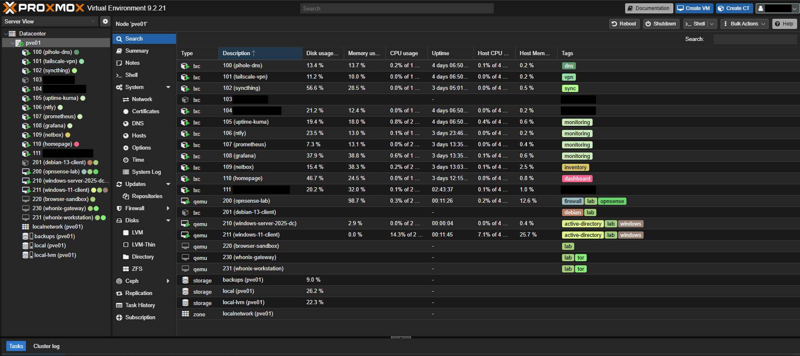

# Node and storage

## What it does

`pve01` is the only server: a small desktop-class machine running Proxmox VE. Every
service in this repository runs on it, as an LXC container or a KVM virtual machine.

## How it is built

| Part | Detail |
|---|---|
| CPU | 4 cores, desktop class |
| Memory | 32 GB |
| System disk | SATA SSD: Proxmox itself and every container and VM disk; to be replaced soon ([TSH-03](../troubleshooting/03-failing-system-ssd.md)) |
| Backup disk | A second SSD, used only for backups |
| Hypervisor | Proxmox VE 9.2, updated from the no-subscription repository; legacy BIOS boot |
| Network | One NIC, attached to the Linux bridge `vmbr0` (the home LAN) |
| Lab networks | `vmbr1`, `vmbr2` and `vmbr3`, Linux bridges with no physical port and no host address ([Labs](09-labs.md)) |

**Storage.** The system disk keeps the installer's default LVM layout on purpose:

| Storage | Type | Holds |
|---|---|---|
| `local` | ext4 (root logical volume) | The OS, ISO images, container templates |
| `local-lvm` | LVM-thin pool | Container and VM disks |
| `backups` | ext4 on the second SSD, `/mnt/pve/backups` | Backup archives only ([Backups](07-backups.md)) |

`backups` is flagged `is_mountpoint`: if the drive is missing, a backup job fails
instead of quietly filling the system disk.

**Containers.** Every service container is Debian 13, unprivileged, with
`nesting=1` (systemd 257 needs it inside unprivileged containers). Each one has:

- a static address that follows its ID: CT 1*xx* is `<lan>.1xx`, and the node is `<lan>.10`;
- a `.lan` name in Pi-hole's local DNS, such as `grafana.lan`;
- tags by function (`dns`, `vpn`, `monitoring`…) and a one-line description;
- start at boot. Lab machines are the exception: they stay off until needed.

| CT | Name | Address |
|---|---|---|
| 100 | `pihole-dns` | `<lan>.100` |
| 101 | `tailscale-vpn` | `<lan>.101` |
| 102 | `syncthing` | `<lan>.102` |
| 105 | `uptime-kuma` | `<lan>.105` |
| 106 | `ntfy` | `<lan>.106` |
| 107 | `prometheus` | `<lan>.107` |
| 108 | `grafana` | `<lan>.108` |
| 109 | `netbox` | `<lan>.109` |
| 110 | `homepage` | `<lan>.110` |
| 112 | `caddy-proxy` | `<lan>.112` |

## Why this way

- **Containers instead of VMs.** The services are Linux daemons. Containers share the
  host kernel, so ten of them use a fraction of the memory that ten VMs would. VMs are
  used only where another kernel is required.
- **Unprivileged containers.** Root inside a container maps to an unprivileged user on
  the host, so a compromised service does not get root on the node.
- **One service per container.** Each one is backed up, restored, updated and rolled
  back with a snapshot on its own, without touching the others.
- **An address plan that can be read.** Knowing the ID is knowing the address, and the
  free addresses are tracked in NetBox ([Inventory](06-inventory-and-dashboard.md)).
- **Backups on another physical disk.** A dead system disk does not take the backups
  with it ([TSH-03](../troubleshooting/03-failing-system-ssd.md)).

## How to verify

On the node:

```sh
pveversion                        # pve-manager/9.2.x
pct list                          # the containers above, running
pvesm status                      # local, local-lvm and backups: active
lvs pve                           # root, swap and the thin pool "data"
pct config 107 | grep -E 'unprivileged|features|onboot|net0'
# unprivileged: 1, features: nesting=1, onboot: 1, net0 ... ip=<lan>.107/24
```

### What it looks like



The node view of `pve01`, captured before CT 112, the HTTPS proxy, was added. Every
service container shown is running and tagged by function.
The lab machines start only when needed: here OPNsense, the domain controller and the
Windows 11 workstation are on for a lab session, and the grey icons are the ones that
are off. The redacted containers belong to other projects and are out of scope here.
