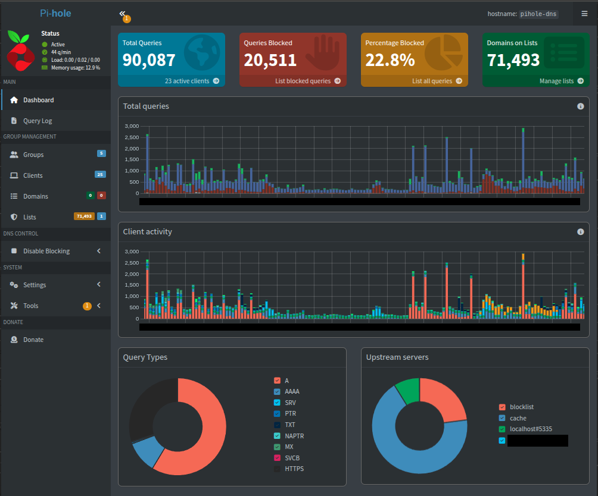
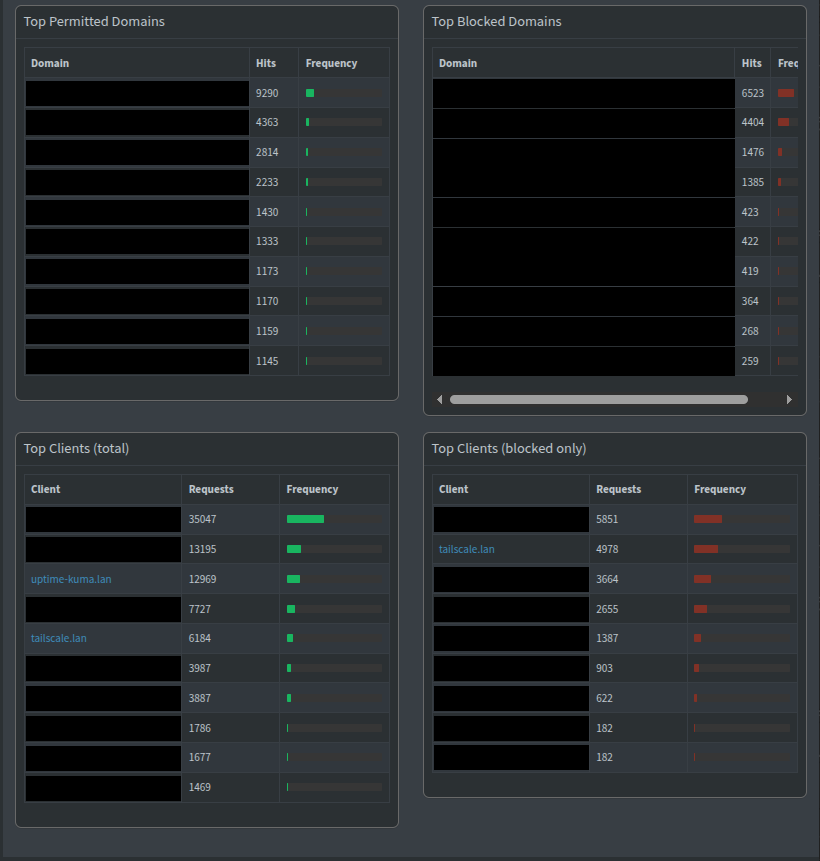

# DNS: Pi-hole and Unbound

## What it does

Every device on the home network uses Pi-hole for DNS. Pi-hole blocks advertising,
tracking and malware domains, answers the local `.lan` names of every server and
device, and passes everything else to Unbound, which runs in the same container.
Unbound sends those queries to Quad9 inside an encrypted TLS connection and validates
DNSSEC on the answers. Nothing Pi-hole passes on leaves the house in plain text.

## How it is built

- **CT 100 `pihole-dns`**, at `<lan>.100`, starts at boot.
- **Pi-hole v6**, with the StevenBlack unified blocklist applied to every client group.
- **Every device has a fixed `.lan` name** and belongs to a client group (household
  devices, servers, Tailscale). Pi-hole is also the DHCP server, so it knows the name
  behind every address it hands out, and the query log shows names instead of bare
  addresses.
- **Unbound** (Debian package) listens only on `127.0.0.1:5335`, inside the container.
  Pi-hole's only upstream is `127.0.0.1#5335`. The configuration follows the Pi-hole
  guide for Unbound: [`configs/dns/unbound-pi-hole.conf`](../configs/dns/unbound-pi-hole.conf).
  - DNSSEC is validated by Unbound. Pi-hole's own DNSSEC option stays off, so there
    is one validator in the house, not two. Quad9 validates too, on its side, but
    Unbound does not rely on it.
  - It never returns private addresses for public names (DNS rebinding protection).
  - `qname-minimisation: no` — see [TSH-02](../troubleshooting/02-recursive-dns-nxdomain.md)
    (no effect while every query is forwarded to Quad9).
  - **DNS over TLS to Quad9.** A second file forwards every zone to `9.9.9.9` and
    `149.112.112.112` on port 853, with `forward-tls-upstream: yes`. Unbound checks that
    the server's certificate is valid for `dns.quad9.net` against the system's CA bundle
    before it sends anything:
    [`configs/dns/unbound-forward-quad9.conf`](../configs/dns/unbound-forward-quad9.conf).
- **How clients get it:** Pi-hole's own DHCP server hands out addresses with Pi-hole as
  the only DNS server; the router's DHCP is off. Known devices have reservations by MAC
  address, the rest get an address from a dynamic pool, and leases last three days.
  IPv6 is disabled on the LAN, so no IPv6 resolver can bypass Pi-hole.
- **Devices on Tailscale** also use Pi-hole: it is the tailnet's DNS server, with or
  without the exit node ([Remote access](03-remote-access.md)).
- **Rollback points:** a snapshot of the container before every Pi-hole upgrade or
  resolver change, and a Teleporter export of Pi-hole's settings on the backup disk.

## Why this way

- **`.lan` is a convenience, not a standard.** It is short and many home routers use it,
  but it is not reserved: the names set aside for a home network are `home.arpa`
  (RFC 8375) and, more recently, `.internal`. Moving to one of them would mean renaming
  every panel, reissuing the HTTPS certificates and changing every record, so the house
  keeps `.lan`; nothing outside it ever resolves these names.
- **Encrypted forwarding, because recursion was not possible here.** Before Unbound,
  Pi-hole forwarded to Google and Cloudflare in plain text. Unbound was then set up as a
  recursive resolver, meant to ask the root servers and each domain's own servers
  directly. It later turned out that the upstream network answers every plain DNS query
  itself, whatever address it is sent to
  ([TSH-04](../troubleshooting/04-isp-intercepted-dns.md)). The "recursive" resolver was
  really being served by the ISP's resolver, and port 53 cannot be made to reach anyone
  else. Encryption is the only way past that, and it needs a resolver at the other end.
- **Why Quad9.** A non-profit foundation that does not log the addresses of the clients
  that query it, under Swiss privacy law, and that blocks known malware domains on top
  of the Pi-hole blocklist. The trade-off is stated plainly: Quad9 sees the names the
  house looks up, instead of the ISP. The ISP still sees which addresses the devices
  connect to afterwards, and the site name in most HTTPS handshakes; this hides DNS, it
  is not a VPN. A new name resolves in about 90 ms; repeated ones come from the cache.
- **DHCP on Pi-hole, not on the router.** The router's DHCP server always added the
  router itself as a second DNS server, and its firmware has no option to stop it.
  Clients do not keep a second server only for emergencies: many use it whenever the
  first one is slow, so part of the house's queries skipped the blocklist and left
  unencrypted. With Pi-hole handing out addresses, it is the only resolver any device
  is given.
- **Unbound in the same container as Pi-hole.** It only ever talks to Pi-hole, over the
  loopback interface, so nothing else on the network can use it as an open resolver.

**Limit:** there is only one Pi-hole and no fallback resolver. If CT 100 stops, the house
loses DNS at once, and new devices get no address until it is back; existing leases
last three days. The way back is to turn the router's DHCP on again, with the router as
DNS server, and reconnect the devices.

## How to verify

On the node:

```sh
pct exec 100 -- pihole-FTL --config dns.upstreams
# [ 127.0.0.1#5335 ]
pct exec 100 -- systemctl is-active unbound
# active
pct exec 100 -- dig @127.0.0.1 -p 5335 dnssec-failed.org | grep status
# status: SERVFAIL     (a domain whose signatures are broken on purpose)
pct exec 100 -- dig @127.0.0.1 -p 5335 isc.org +dnssec | grep flags
# flags: qr rd ra ad   (ad = validated)
pct exec 100 -- unbound-checkconf
# unbound-checkconf: no errors in /etc/unbound/unbound.conf
```

From any device on the LAN:

```sh
nslookup doubleclick.net <lan>.100     # 0.0.0.0 (blocked)
nslookup grafana.lan <lan>.100         # <lan>.112 (local record: the HTTPS proxy)
nslookup -type=TXT proto.on.quad9.net <lan>.100
# "dot"   (Quad9 reports that the query reached it over DNS over TLS)
```

### What it looks like



The dashboard over the last 24 hours, captured before Pi-hole took over DHCP. Under
*Upstream servers*, most answers come from the cache and the blocklist, and
`localhost#5335` is Unbound. The redacted entry is the router: at the time, Pi-hole asked
it for the names of the devices it did not know (conditional forwarding). Now Pi-hole
hands out the addresses and knows every name itself, so that forwarding was removed.



The four top lists, further down the same dashboard. The most blocked domains are
telemetry and ad networks. Pi-hole also blocks the private relay services some
operating systems offer by default; I kept that default. A relay would send those
devices' traffic and DNS past the blocklist; on this network, filtering for every device
matters more than hiding browsing from the ISP. The domain names, which would show the
kinds of devices and apps at home, and the names of the household devices are
redacted; `uptime-kuma.lan` and `tailscale.lan` are the homelab's own clients: the monitoring probes and the
devices connected through the VPN.
