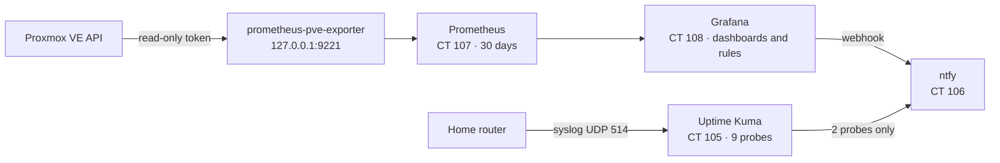
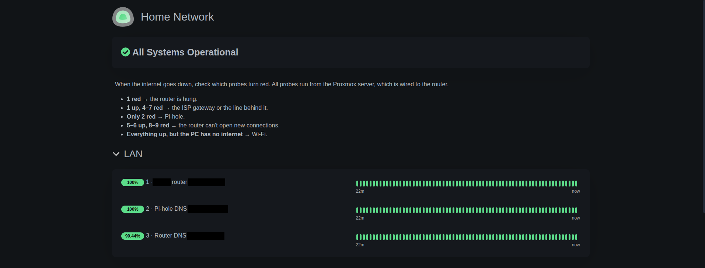
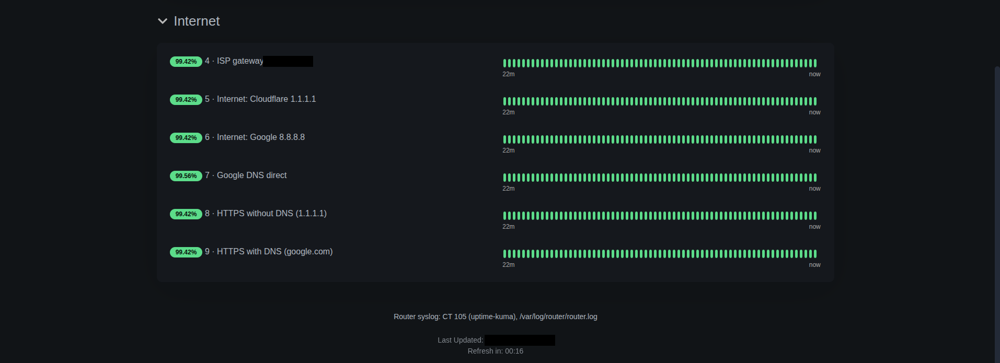
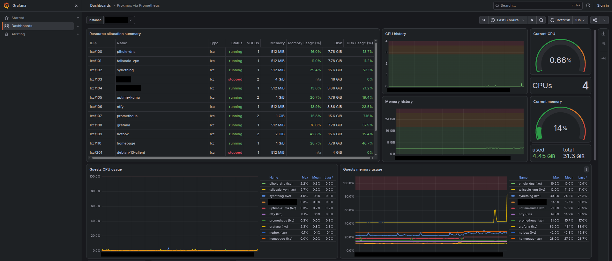
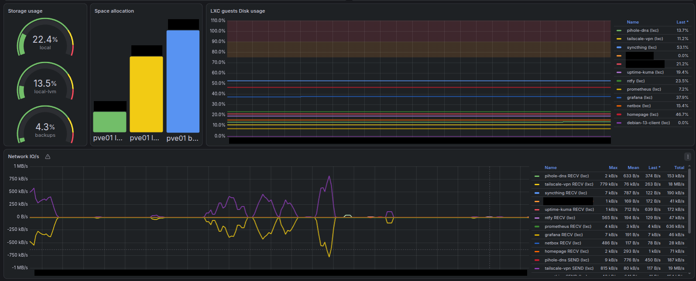
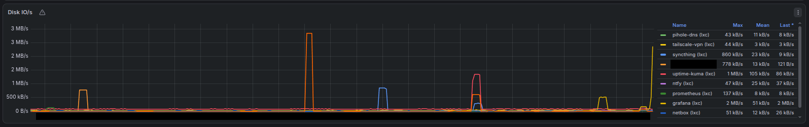

# Monitoring: Uptime Kuma, Prometheus and Grafana

Two tools for two different questions. Uptime Kuma answers *is it working right now,
and which part of the path failed?* Prometheus and Grafana answer *what happened over
time?* — a CPU spike at night, a container that keeps growing, a disk filling up.



## Uptime Kuma: which segment failed

### How it is built

- **CT 105 `uptime-kuma`**, Uptime Kuma 2.5, installed from its Git release tag with its
  own system user and systemd service. History is kept for 180 days, and update checks
  are off.
- **Nine probes, every 20 seconds with one retry,** in two groups. Each one tests one
  more piece of the path from the server to the internet:

| # | Probe | Type | What a failure means |
|---|---|---|---|
| 1 | Home router | Ping | The router is down or hung |
| 2 | Pi-hole DNS | DNS query to Pi-hole | DNS for the LAN is broken |
| 3 | Router DNS | DNS query to the router | The router's own resolver is broken; with 2 up, Pi-hole is fine and the fault is in the router |
| 4 | ISP gateway | Ping to the ISP's device in front of the home router | The line to the ISP |
| 5 | Cloudflare `1.1.1.1` | Ping | No route to the internet |
| 6 | Google `8.8.8.8` | Ping | No route to the internet |
| 7 | Google DNS direct | DNS query to `8.8.8.8`, bypassing Pi-hole; the ISP intercepts it and answers it itself ([TSH-04](../troubleshooting/04-isp-intercepted-dns.md)) | The ISP's DNS on port 53 |
| 8 | HTTPS without DNS | `GET https://1.1.1.1/cdn-cgi/trace` | New TCP and TLS connections fail |
| 9 | HTTPS with DNS | `GET https://www.google.com/generate_204` | The whole path, as a user sees it |

- **A status page** ("Home Network") opens without a login, from my devices only like
  every panel ([Firewall](10-firewall.md)), and tells the reader how to interpret it.
  Its key reads:
  - **1 red** → the router is hung.
  - **1 up, 4–7 red** → the ISP gateway or the line behind it.
  - **Only 2 red** → Pi-hole.
  - **5–6 up, 8–9 red** → the router can't open new connections.
  - **Everything up, but the PC has no internet** → Wi-Fi.

  When the router hangs, 3–9 turn red along with 1; 2 can stay green for a while, as
  long as Pi-hole still has the answer in its cache.
- **Ping without root.** Uptime Kuma runs as an unprivileged user inside an
  unprivileged container. `net.ipv4.ping_group_range` is set to `0 65535`; the commonly
  suggested `0 2147483647` is rejected with *Invalid argument* in this kind of container.
- **The router's syslog lands here.** The router sends its log over UDP 514; rsyslog
  writes it to `/var/log/router/router.log`, and logrotate keeps 26 weekly files
  ([`configs/monitoring/`](../configs/monitoring/)). The router's own log is only saved
  once an hour and loses whatever happened just before a hang
  ([TSH-01](../troubleshooting/01-internet-outages.md)).
- **Rebuilt by a script.** [`kuma-setup.js`](../configs/monitoring/kuma-setup.js) creates
  the admin user, settings, probes and status page through Uptime Kuma's Socket.IO
  API. It matches probes by name, so running it again only adds what is missing.
- **Alerts:** only probes 2 and 9 notify ntfy, so one internet outage sends one or two
  alerts instead of nine ([Alerting](05-alerting.md)).

## Prometheus and Grafana: what happened over time

### How it is built

- **CT 107 `prometheus`**: Prometheus from the Debian package. It scrapes every
  30 seconds ([`prometheus.yml`](../configs/monitoring/prometheus.yml)) and keeps 30 days
  (`--storage.tsdb.retention.time=30d` in `/etc/default/prometheus`).
- **prometheus-pve-exporter** (from PyPI, in its own virtualenv) runs in the same
  container and listens only on `127.0.0.1:9221`. It reads the Proxmox API with the
  token `prometheus@pve!exporter`. The user `prometheus@pve` has the `PVEAuditor` role
  on `/`, and the token has no privilege separation, so it inherits exactly that: it
  can read everything and change nothing. Its systemd unit is sandboxed
  ([`prometheus-pve-exporter.service`](../configs/monitoring/prometheus-pve-exporter.service)).
- **CT 108 `grafana`**: Grafana from Grafana's own repository. Its data source and
  dashboards are provisioned from files, and its settings are environment variables in
  a systemd override, so the packaged `grafana.ini` stays untouched
  ([`grafana-override.conf`](../configs/monitoring/grafana-override.conf)). The home
  dashboard is the community dashboard *Proxmox via Prometheus* (grafana.com 10347).
- **Access:** the devices the [firewall](10-firewall.md) lets in can view the dashboards
  without a login (anonymous *Viewer*); changing anything needs the admin login. Usage reports, update checks, news and Gravatar are
  off.
- **Three alert rules**, provisioned from a script
  ([`make-rules.py`](../configs/monitoring/make-rules.py)) and evaluated every minute:

| Rule | Fires when | Example |
|---|---|---|
| Container down | A container set to start at boot has been stopped for 2 minutes | Pi-hole stopped at 10:00 → alert around 10:02 |
| Disk almost full | Over 85 % for 10 minutes, on any container, the node or a storage | Pi-hole's 7.78 GiB disk alerts above about 6.6 GiB |
| Memory high | Over 90 % for 10 minutes, on any container or the node | Pi-hole's 512 MB container alerts above about 460 MB |

- **Notifications** go to ntfy through a webhook contact point with its own token. A
  custom payload template ([`ntfy-payload.tmpl`](../configs/monitoring/ntfy-payload.tmpl))
  sends high priority when an alert fires, low priority when it resolves, and a
  reminder every 12 hours while it lasts.
- **Tested** end to end: the contact point test, and a real *Memory high* alert raised
  by lowering its threshold to 10 % for a moment, followed by its *resolved* message.

## Why this way

- **Segment probes instead of one "is the internet up" check.** A single check says
  that something is wrong; nine probes along the path say where.
- **The exporter only on localhost, with a read-only token.** The API token never
  leaves the Prometheus container, and the exporter cannot be scraped by anyone else.
- **Containers that should be running, not all containers.** The *Container down* rule
  multiplies by Proxmox's start-at-boot flag, so a lab machine that is off on purpose
  does not raise an alert.

**Limit:** all of the monitoring lives on `pve01`. If the node itself goes down, nothing
sends an alert.

## How to verify

On the node:

```sh
pct exec 105 -- systemctl is-active uptime-kuma rsyslog        # active, active
pct exec 105 -- tail -n 3 /var/log/router/router.log           # recent router lines
pct exec 107 -- systemctl is-active prometheus prometheus-pve-exporter
pct exec 107 -- curl -s http://127.0.0.1:9090/api/v1/targets | grep -o '"health":"[a-z]*"'
# "health":"up" for both jobs
pveum acl list | grep PVEAuditor                               # / prometheus@pve and / homepage@pve
```

From one of my devices ([Firewall](10-firewall.md)): `https://grafana.lan` opens the
Proxmox dashboard without a login,
and `https://grafana.lan/alerting/list` shows the three rules in *Normal* state.

### What it looks like





The status page Uptime Kuma serves, *Home Network*: the key to read it at the top and
one probe per segment, grouped into LAN and Internet. The real addresses, the router's
make and the time of the last update are redacted.



The *Proxmox via Prometheus* dashboard, opened without a login as an anonymous viewer.
The table lists the containers with their allocated resources and state (the capture
predates CT 112, the HTTPS proxy); on the right, the node's CPU and memory over the last
six hours.





Further down: storage, disk usage and network and disk traffic per container. The
node's address, the disk sizes and the names of the containers that belong to other
projects are redacted.
