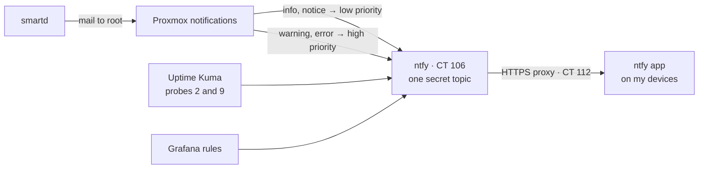

# Alerting: ntfy

## What it does

Every alert from the server ends up as a push notification on my devices: Proxmox
events (backups, updates, errors), the health of the system disk, the network probes
and the Grafana rules. Routine reports arrive silently; real problems pop up on the
screen. No email account and no third-party push service is involved.



## How it is built

- **CT 106 `ntfy`**, ntfy from its official repository, listening on port 80 for the alert
  senders inside the server. My devices reach it only through the HTTPS proxy, at
  `https://ntfy.lan`: over the LAN at home and through Tailscale anywhere else
  ([`server.yml`](../configs/alerting/ntfy-server.yml), [Firewall](10-firewall.md#https-for-the-panels)).
- **Deny by default.** `auth-default-access: deny-all` and no sign-up. There is one
  topic, with a random name. Everyone may read it, which lets my devices subscribe
  without a password; only the user `alerts-publisher` may write to it. Reading
  without a password is a deliberate trade-off: the firewall lets only the HTTPS proxy,
  which answers only my devices, and the alert senders reach ntfy at all
  ([Firewall](10-firewall.md)).
- **One token per sender.** Proxmox, Uptime Kuma and Grafana each publish with their
  own access token, so any one of them can be revoked without touching the others;
  smartd's alerts travel inside Proxmox's, so it has no token of its own (an unused one
  was revoked). The topic and the tokens live in a root-only directory on the node and
  are read from there, never typed. The setup script creates the topic and the first
  tokens once and keeps them on later runs
  ([`setup-ntfy.sh`](../configs/alerting/setup-ntfy.sh)); Grafana's was added later with
  the same `ntfy token add` command.
- **Proxmox's notification system** has two ntfy targets and routes by severity:
  - `info` and `notice` (backup reports, available updates) → low priority, silent, as
    one line: the title says what happened and the body points to Proxmox's task history;
  - `warning`, `error` and `unknown` → high priority with 🚨, shown on screen, with the
    full report.
- **smartd** watches the disks. Its mail to `root` becomes a Proxmox notification and
  follows the same path. It is tuned to report only when the bad-sector counters
  change, not on every boot: `-C 197+ -U 198+ -R 5!`
  ([TSH-03](../troubleshooting/03-failing-system-ssd.md)).
- **Uptime Kuma** notifies only from its *Pi-hole DNS* and *HTTPS with DNS* probes
  ([`kuma-ntfy.js`](../configs/alerting/kuma-ntfy.js)), and **Grafana** from its three
  rules ([Monitoring](04-monitoring.md)).
- **Message size raised to 32 KB.** The backup report for every container is longer
  than ntfy's 4 KB default, and ntfy rejected it with *attachments not allowed*. The
  app connects straight to this server, without Firebase, so the larger limit is
  safe.
- **My devices** run the ntfy app, subscribed to the topic through
  `https://ntfy.lan`, the HTTPS proxy ([Firewall](10-firewall.md#https-for-the-panels)).
  Battery optimization is off for the app, so the system does not put its connection to
  sleep. Away from home it connects through Tailscale; while it is offline, ntfy keeps
  messages for 72 hours.

## Why this way

- **Self-hosted instead of email.** The alerts go from the server to my devices and
  nowhere else, and no outside account can lock them out or read them.
- **Severity decides how loud.** A nightly backup report should not wake anyone up; a
  failing disk should.
- **Few alerts, each one meaningful.** smartd reports changes, not states; Uptime Kuma
  alerts from two probes, not nine. An alert that fires every day stops being read.

**Limit:** ntfy runs on `pve01`. If the whole node goes down, there is nobody left to
send the alert.

## How to verify

On the node:

```sh
pct exec 106 -- systemctl is-active ntfy                       # active
T=$(cat /root/ntfy/topic)
curl -s -o /dev/null -w '%{http_code}\n' -d test http://<lan>.106/$T
# 403: nobody can publish without a token
pvesh get /cluster/notifications/matchers --output-format yaml
# one matcher for info,notice and one for warning,error,unknown, each to its own target
grep ^DEVICESCAN /etc/smartd.conf                              # ... -C 197+ -U 198+ -R 5! ...
```

*Datacenter → Notifications → Test* on either target puts a test message on my devices:
low priority from one, high priority from the other.
