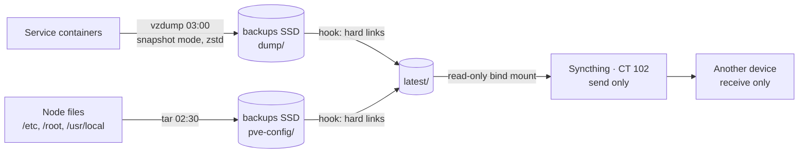
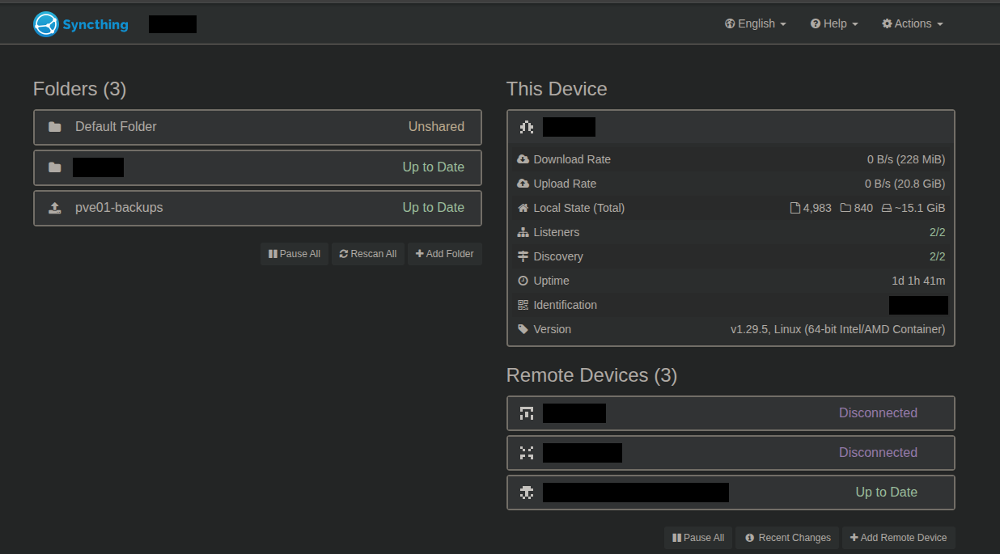

# Backups

## What it does

Every service container is backed up each night to a dedicated SSD, with daily,
weekly and monthly copies kept. The node's own configuration is archived each night
too. The newest copy of everything is then synced, one way, to another device at home, so a
dead server does not take its backups with it. A container has been restored from its
nightly backup, started and checked; a full node rebuild has not been tested.



## How it is built

- **The disk:** a second SSD used for nothing else, mounted as the Proxmox storage
  `backups` with `is_mountpoint 1`: if the drive is missing, the job fails instead of
  writing to the system disk ([Node and storage](01-node-and-storage.md)).
- **The job** (*Datacenter → Backup*):
  - every day at 03:00; if the node was off at that time, it runs when it boots;
  - every guest, including ones created later, except the lab machines;
  - snapshot mode, so nothing is stopped; zstd compression;
  - retention: 7 daily, 4 weekly and 3 monthly copies, at most 14 per container;
  - each job's report goes to my devices at low priority ([Alerting](05-alerting.md)).
- **The node's configuration.** Container backups do not include the host itself:
  networking, storage definitions, the backup job, `/etc/pve`, the setup files and
  secrets kept in `/root` (the ntfy tokens, the monitoring and NetBox setup) and the
  scripts in `/usr/local/sbin`. A systemd timer runs a small script at 02:30 every
  night that archives `/etc`, `/root` and `/usr/local` (about 1.2 MB) to
  `backups/pve-config/<hostname>-config-<date>.tar.gz` and keeps the last 14
  ([`configs/backups/`](../configs/backups/)).
- **The copy off the server:**
  - When the job ends, a vzdump hook script
    ([`vzdump-hook`](../configs/backups/vzdump-hook) →
    [`pve-latest-copy`](../configs/backups/pve-latest-copy)) refreshes `backups/latest/`
    with the newest archive of each container and the newest configuration archive.
    These are hard links with fixed names, so they take no extra space, and each one is
    swapped in atomically.
  - The Syncthing container mounts that folder **read-only** and shares it as a
    send-only folder. The receiving device takes it into a receive-only folder. If it
    was off, it catches up when it starts.
  - The receiving device holds only the newest night (about 9.5 GB); the history stays on the server.
- **Snapshots before risky changes,** such as system updates or a resolver change, as a
  quick rollback point next to the backups.

## Tested

- **Restore:** the alert server's newest nightly backup ([Alerting](05-alerting.md))
  was restored under a spare ID. Before it started, its network link was set down
  (`link_down=1`), so the copy could not clash with the original's address or name.
  Inside the copy, ntfy was running and its health endpoint answered
  `{"healthy":true}`, with the same version and the same users as the original. The
  test container was then destroyed with `--purge`. From restore to removal took under
  a minute.
- **Not tested yet:** rebuilding the node itself (reinstalling Proxmox, bringing back
  the node's files from the configuration archive and restoring every container),
  which is what replacing the failing system disk would take
  ([TSH-03](../troubleshooting/03-failing-system-ssd.md)).
- **Timing:** the first run backed up the five containers that existed then in 1 min
  25 s. A manual run of every container after the disk alert in
  [TSH-03](../troubleshooting/03-failing-system-ssd.md) took 4 min 32 s and wrote about
  9.5 GB.

## Why this way

- **A separate physical disk.** A snapshot lives on the same disk as the container, and
  so would a backup on `local`. When the system disk started failing, the backups were
  already somewhere else.
- **Daily, weekly and monthly retention.** It covers "I broke it yesterday" and "this
  has been wrong for weeks" with at most 14 copies per container.
- **Hard links instead of copies,** so the sync folder costs no space and always has
  fixed file names for Syncthing to follow.
- **Read-only mount and one-way sync.** The sync container cannot modify a backup, and
  a file deleted or changed on the receiving device never travels back to the server.
- **Lab machines excluded.** They are disposable and rebuildable; including them would
  multiply what crosses the network every night.

**Limit:** both copies are in the same house.

## How to verify

On the node:

```sh
pvesm status | grep backups                     # backups  dir  active
cat /etc/pve/jobs.cfg                           # schedule 03:00, prune-backups keep-daily=7,keep-monthly=3,keep-weekly=4
pvesm list backups | tail                       # an archive of every container from the last 24 hours
ls /mnt/pve/backups/latest                      # ct<id>-<name>.tar.zst per container and <hostname>-config.tar.gz
systemctl list-timers pve-config-backup.timer   # next run tonight at 02:30
tar -tzf /mnt/pve/backups/latest/$(hostname -s)-config.tar.gz | cut -d/ -f1 | sort -u   # etc root usr
grep ^script /etc/vzdump.conf                   # script: /usr/local/sbin/vzdump-hook
```

On the receiving device, the same files appear in the receiving folder with matching
SHA-256 hashes (`sha256sum` on the node, the same check on the device).

### What it looks like



Syncthing in CT 102. `pve01-backups` is the folder with the newest backups; the upload
icon marks it as send only, so nothing on the receiving device can change what the server holds. The
other shared folder, the device names and the device ID are redacted.
