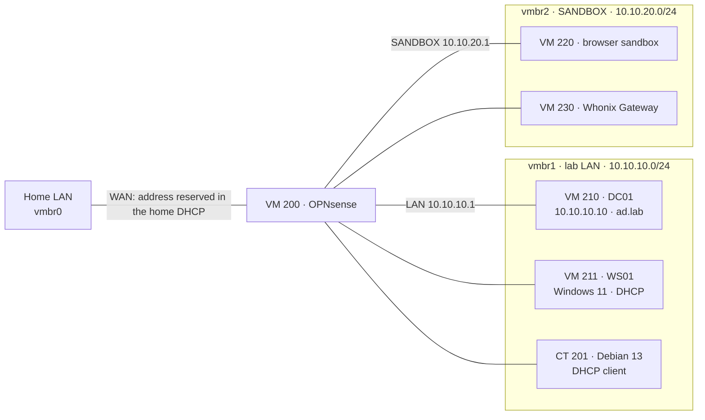

# Labs: OPNsense and Active Directory

## What it does

Networks inside the server, each on a bridge of its own, for practicing firewalling
and Windows domain administration without touching anything real. An OPNsense
firewall is their router. Behind it, the lab LAN holds a Debian client, a Windows
Server domain controller and a Windows 11 workstation joined to its domain; a second
network, SANDBOX, holds the disposable browsers
described in [Browser sandbox](11-browser-sandbox.md) and
[Tor isolation](12-tor-isolation.md).

Both lab networks are locked out of the home network: they reach the internet and the
DNS they need, nothing else. The lab LAN asks OPNsense, which forwards to the Pi-hole;
SANDBOX asks the Pi-hole directly.



## How it is built

**The internal bridges.** `vmbr1` (lab LAN) and `vmbr2` (SANDBOX) are Linux bridges with
no physical port and no address on the host. Nothing attached to them can reach the
home network except through OPNsense, and each lab has its own bridge so that rules for
one cannot break the other.

**VM 200 `opnsense-lab`: OPNsense 26.7**

- The installer image was checked against the SHA-256 published by OPNsense before
  use.
- Installed on UFS on a 20 GiB disk; 2 cores, 4 GiB of RAM.
- Three network cards, in this order:

| Card | OPNsense interface | Bridge | Address |
|---|---|---|---|
| `net0` · `vtnet0` | LAN | `vmbr1` | `10.10.10.1/24`, DHCP for `.100`–`.199` with DNS `10.10.10.10` and domain `ad.lab` |
| `net1` · `vtnet1` | WAN | `vmbr0` | DHCP from the home LAN (Pi-hole), reserved as `<lan>.200` |
| `net2` · `vtnet2` | `opt1` SANDBOX | `vmbr2` | `10.10.20.1/24`, DHCP for `.100`–`.199`, no IPv6 |

- DHCP is served by Dnsmasq. Outbound NAT is automatic: both lab networks leave
  through the WAN address.
- **Web interface:** reachable from the lab LAN and, on the WAN, only from my own
  devices. One WAN rule passes TCP 443 to the firewall itself from an alias that holds
  the same device list as the [node firewall](10-firewall.md).
- **WAN options:** *Block private networks* and *Block bogon networks* are off, because
  this WAN faces the home LAN (a private network), not the internet. *Allow DNS server
  list to be overridden by DHCP/PPP on WAN* is off too
  ([why](11-browser-sandbox.md#lesson-learned-the-pi-hole-saw-the-router-instead-of-the-sandbox)).
- **DNS:** OPNsense's Unbound forwards every query to the Pi-hole (*Query Forwarding*,
  all domains), so the labs get the home blocklist, DNSSEC validation and the encrypted
  upstream ([DNS](02-dns.md)). It started as a recursive resolver, which never worked on
  this network: [TSH-04](../troubleshooting/04-isp-intercepted-dns.md).
- **DHCP options on the lab LAN:** option 6 (DNS server) is the domain controller,
  `10.10.10.10`, and option 15 (domain name) is `ad.lab`, so clients find the domain
  without manual settings. SANDBOX hands out the Pi-hole instead.
- The WAN address has a local name in Pi-hole, `opnsense-lab.lan`, so everything the
  labs send to the home DNS shows up under that name.

**Firewall rules on the lab LAN**, evaluated in this order:

| # | Action | Match | Why |
|---|---|---|---|
| 100 | Pass | TCP/UDP 53 to OPNsense's LAN address | The domain controller forwards its DNS there, and OPNsense forwards it to the Pi-hole |
| 110 | Pass | UDP 123 to OPNsense's LAN address | The domain's time source |
| 300 | Block and log | `10.0.0.0/8`, `172.16.0.0/12`, `192.168.0.0/16` | Every private range: the home LAN and SANDBOX |
| 400 | Pass | Anything | The internet: Windows Update, activation |

OPNsense's automatic rules come first: DHCP, and the anti-lockout rule that keeps its
web interface reachable from this network. No rule lets the lab reach the Pi-hole
itself: the query that gets there comes from OPNsense, which these rules do not filter.
Traffic between the lab machines stays on the bridge and never reaches the firewall.

Tested from the domain controller: before the rules, the home router and the Pi-hole
answered; after them, both time out and OPNsense logs each attempt against rule 300,
while DNS, the domain lookup, the time sync and the internet keep working.

**CT 201 `debian-13-client`:** a minimal Debian 13 container whose only interface is on
`vmbr1`. It received a DHCP lease from OPNsense (`10.10.10.192`), and it was briefly moved
to `vmbr2` to test the SANDBOX rules.

**VM 210 `windows-server-2025-dc`: Windows Server 2025 (evaluation), domain controller `DC01`**

- q35 machine with UEFI, VirtIO SCSI disk and VirtIO network. The storage driver is
  loaded from the virtio-win ISO during setup, then the guest tools are installed,
  including the QEMU guest agent.
- Static address `10.10.10.10/24`, gateway `10.10.10.1`.
- Roles: AD DS and DNS. New forest **`ad.lab`** (NetBIOS `LAB`), forest and domain
  functional level Windows Server 2025. DNS forwards to OPNsense.
- Organizational units, all protected from accidental deletion:

```text
ad.lab
└── Lab
    ├── Users
    │   ├── IT
    │   ├── Sales
    │   └── HR
    ├── Groups
    ├── Computers
    │   ├── Workstations
    │   └── Servers
    └── Service Accounts
```

- Global groups `GG-IT`, `GG-Sales` and `GG-HR`, all three nested in `GG-All-Staff`.
- Default domain password policy: at least 10 characters, complexity on, lockout after
  5 failed attempts for 15 minutes.
- Group Policy:
  - `Lab - Logon banner`, linked to `Computers`: a legal notice before sign-in;
  - `Lab - Sales no Control Panel`, linked to `Sales`: removes Control Panel and Settings
    for that department.
- **Time:** the domain's time source. It takes the time from OPNsense
  (`w32tm /config /manualpeerlist:10.10.10.1 /syncfromflags:manual /reliable:yes /update`), and
  the domain members take it from the domain controller.

**VM 211 `windows-11-client`: Windows 11 Enterprise (evaluation), workstation `WS01`**

- Same build as the domain controller: q35, UEFI, VirtIO SCSI disk and VirtIO network,
  plus a virtual TPM 2.0, which Windows 11 requires. 2 cores, 8 GiB of RAM, 64 GiB disk.
- Set up offline with a local account; the guest tools came next, which also installed
  the network driver. Windows was activated once the lab DNS worked.
- Address from OPNsense's DHCP. The DHCP options give it the domain controller as its
  DNS server and `ad.lab` as its suffix, so it finds `_ldap._tcp.dc._msdcs.ad.lab`.
- **Joined with an offline domain join**, with no domain password typed on the client:
  - on `DC01`, `djoin /provision /domain ad.lab /machine WS01 /machineou
    "OU=Workstations,OU=Computers,OU=Lab,DC=ad,DC=lab" /savefile C:\odj-ws01.txt`
    created the computer account in its OU and wrote the provisioning file;
  - the file went to the client through the guest agent, with the same SHA-256 on both
    sides;
  - `djoin /requestodj /loadfile C:\odj-ws01.txt /windowspath C:\Windows /localos` applied it on the
    next reboot. The file holds the computer account's password, so it was deleted
    from both machines afterwards.
- **Group Policy:** `gpresult /scope computer` lists `Lab - Logon banner` and the
  Default Domain Policy as applied.

**Operation.** The lab machines do not start with the node and are shut down after
use. They are excluded from the nightly backups: they are disposable and can be
rebuilt from these pages. Start OPNsense first and give it a minute; for the domain,
the domain controller before the workstation.

## Why this way

- **Bridges with no uplink.** Nothing on them has a path out except through OPNsense,
  so every packet that leaves a lab crosses one firewall, where it can be logged or
  blocked. Both labs block the home network there.
- **OPNsense as the domain's router.** The domain controller and the clients sit
  behind a real firewall, the way a branch network would.
- **One bridge per lab.** The domain controller forwards its DNS to OPNsense on the lab
  LAN, so the sandbox's rules, which allow DNS only to the Pi-hole, would have broken
  the domain on that same network. A separate interface gets its own rule set.
- **`ad.lab` is a lab name.** `.lab` is not a reserved top-level domain, and a real
  forest should live under a domain the organization owns, such as `ad.example.com`, so
  that its names can never collide with a public domain. For a lab that never leaves
  its bridge, the short name was kept; renaming a forest means rebuilding it.
- **The domain structure separates people, groups and computers,** so Group Policy can
  target a department or a class of machines without touching the rest.
- **Offline domain join.** The computer account is created straight in the right OU,
  so policies apply from the first boot, and no domain administrator password is typed
  on a client.
- **One time source.** Kerberos rejects clocks more than five minutes apart. Both
  Windows VMs first kept their default time zone and read the VM clock, which follows
  the node's local time, so their UTC time was hours off; with the time zone corrected
  and the hierarchy
  above (OPNsense, then the domain controller, then the members), they agree.

## Lesson learned: the first NIC is the LAN

In the first design the VM's first network card was the WAN, attached to the home
bridge. OPNsense runs its installer with the default configuration, and that default
makes the first card the LAN, with factory settings meant for a network of its own. For
a while, the home network had a second firewall on it, configured for somewhere else.

For the 26 minutes the VM ran like that, through the installer and the reboot after
it, Uptime Kuma recorded every probe from the router's DNS onwards failing, while the
probe that pings the router stayed green. The probes recovered in the same minute the
VM was stopped.

The fix was to swap the cards (first card on `vmbr1`, second on `vmbr0`), remove the
installer image and keep the WAN link down until the LAN had its lab address. The rule
since then: a new firewall never joins a live network with its factory settings.

## Lesson learned: replies to the home LAN went to the router

With the WAN rule for my devices in place, the web interface still did not load from
my device. The state table showed the connection stuck in `SYN_SENT`: OPNsense
received the request but sent the answer to the router. A pass rule on a WAN interface
gets `reply-to` the WAN gateway by default, which is right for traffic from the
internet and wrong for a WAN that is itself a LAN; the router dropped the answer.
Ticking *Disable reply-to* on that one rule fixed it.

One more trap on the way: every filter reload, including the one that applies a new
alias, turns the packet filter back on. When working from the console with the filter
off (`pfctl -d`), the WAN rule has to exist before any alias is applied. Adding an
address to an alias by hand (`pfctl -t <alias> -T add`) does not last either:
OPNsense reloads its alias tables from the saved configuration every few minutes.

## How to verify

On the node:

```sh
ip -br addr show vmbr1                                   # the lab bridge, no address
ip -br addr show vmbr2                                   # the sandbox bridge, no address
qm config 200 | grep -E '^net[012]'                      # net0 vmbr1, net1 vmbr0, net2 vmbr2
pct config 201 | grep net0                               # bridge=vmbr1, ip=dhcp
qm config 210 | grep -E '^(bios|machine|net0|agent)'     # ovmf, q35, vmbr1, agent 1
```

With VM 200 running, its console shows the three interfaces:

```text
LAN (vtnet0)     -> v4: 10.10.10.1/24
SANDBOX (vtnet2) -> v4: 10.10.20.1/24
WAN (vtnet1)     -> v4/DHCP4: <lan>.200/24
```

From one of my devices `https://<lan>.200` opens the web interface, and ports 80 and 22
do not answer.

With VM 210 running, through the guest agent:

```sh
qm guest exec 210 -- powershell -c "(Get-ADDomain).DNSRoot; (Get-ADOrganizationalUnit -Filter * -SearchBase 'OU=Lab,DC=ad,DC=lab').Count"
# ad.lab
# 10   (Lab and the nine units under it)
qm guest exec 210 -- powershell -c "(Get-ADComputer WS01).DistinguishedName"
# CN=WS01,OU=Workstations,OU=Computers,OU=Lab,DC=ad,DC=lab
qm guest exec 210 -- powershell -c "(Resolve-DnsName example.com -DnsOnly).Count -gt 0; (Test-NetConnection 1.1.1.1 -Port 443).TcpTestSucceeded"
# True, True   (DNS and the internet)
qm guest exec 210 -- powershell -c "(Test-NetConnection <lan>.1 -Port 80).TcpTestSucceeded"
# False        (the home router; OPNsense's Live View logs it against rule 300)
```

With VM 211 running as well:

```sh
qm config 211 | grep -E '^(tpmstate0|net0|agent)'        # TPM v2.0, vmbr1, agent 1
qm guest exec 211 -- powershell -c "hostname; (Get-CimInstance Win32_ComputerSystem).Domain; Test-ComputerSecureChannel"
# WS01
# ad.lab
# True
qm guest exec 211 -- powershell -c "gpresult /scope computer /r | Select-String 'Lab - '"
# Lab - Logon banner
qm guest exec 211 -- powershell -c "w32tm /query /source"
# DC01.ad.lab
```
