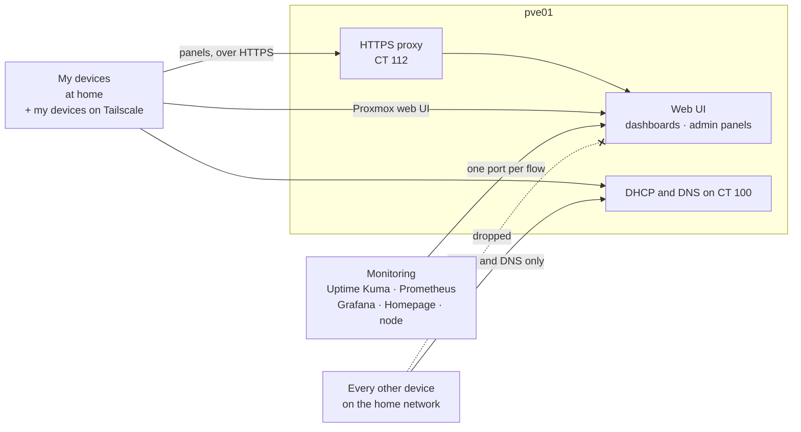

# Firewall: admin access only from my devices

## What it does

The Proxmox firewall decides who can reach the management side of the server. The
Proxmox web interface, every dashboard and every admin panel answer only my own
devices and the services that need them. SSH is off everywhere: on the node and in
every container ([No SSH](#no-ssh)). The rest of the house (every other device,
guests included) still gets its address, DNS and time from Pi-hole, and nothing else.

Before it, anything on the home network could open the Proxmox login page, SSH into
the node and reach every service, including Grafana, which shows its dashboards
without a login.



## How it is built

- **Two IP sets and one alias per server** at datacenter level
  ([`cluster.fw`](../configs/firewall/cluster.fw)):
  - `trusted-devices`: my own devices, each with a reservation in
    Pi-hole's DHCP so its address does not move, plus `<lan>.101`, the Tailscale
    container. Tailscale keeps source NAT on ([Remote access](03-remote-access.md)),
    so everything that comes in through the tailnet arrives with that one address:
    one entry covers all my devices away from home. That is safe only because the
    tailnet policy lets nobody but me use the subnet route
    ([Remote access](03-remote-access.md)); without it, any device added to or shared
    into the tailnet would arrive here as a trusted device.
  - `reverse-proxy`: CT 112, the HTTPS proxy in front of the panels
    ([HTTPS for the panels](#https-for-the-panels)).
  - Aliases such as `grafana`, `ntfy` or `pve01` name each server, so a rule reads as
    source, destination and port.
- **Two security groups.** `admin-access` accepts anything from my devices, plus
  Homepage's status check on Syncthing's port; CT 102 (Syncthing) uses it.
  `panel-access` accepts the proxy and the monitoring services, each only on the port
  it uses ([One rule per flow](#one-rule-per-flow)), plus ping from my devices; the
  panels use it, so my devices reach them only through the proxy. The node has its own
  rules: the web UI and ping from my devices, and the API from Prometheus and Homepage.
  Adding a device is one line in an IP set.
- **Default policy: drop incoming, allow outgoing.** Dropped packets are logged at
  `info` level, rate-limited, in `/var/log/pve-firewall.log` on the node.

| Where | Who gets in |
|---|---|
| CT 105 to CT 110, the panels | `panel-access` only, except SSH ([example](../configs/firewall/ct-panel.fw)). CT 105 also takes syslog (UDP 514) from the router ([`105.fw`](../configs/firewall/105.fw)); CT 106 (ntfy) has the same rules ([`106.fw`](../configs/firewall/106.fw)) |
| CT 112, the HTTPS proxy | HTTPS (443) and the redirect to it (80) from my devices. SSH: nobody ([`112.fw`](../configs/firewall/112.fw)) |
| CT 102, Syncthing | `admin-access` only, except SSH: my devices, and Homepage on the web interface's port ([`ct-admin-only.fw`](../configs/firewall/ct-admin-only.fw)) |
| CT 100, Pi-hole | Everyone: DHCP, DNS, NTP, ping and TCP 7. `panel-access`: the web interface. SSH: nobody ([`100.fw`](../configs/firewall/100.fw)) |
| The node | The web UI (8006) and ping from my devices; the API (8006) from Prometheus and Homepage. Nothing else: not SSH (22), the SPICE proxy (3128) or rpcbind (111) ([`host.fw`](../configs/firewall/host.fw)) |
| CT 101, Tailscale | No guest firewall. It must accept WireGuard from anywhere and forward the tailnet's traffic |
| The lab LAN on `vmbr1` | No guest firewall. A bridge of its own behind OPNsense, which blocks every private range from it: it reaches the internet and, on OPNsense itself, DNS, time and the web interface ([Labs](09-labs.md)) |
| VM 220, the browser sandbox | Nothing in. Out: DNS only to Pi-hole, no private ranges ([Browser sandbox](11-browser-sandbox.md)) |
| VMs 230 and 231, Whonix | The Workstation talks only to the Gateway; the Gateway accepts only the Workstation and reaches no private range ([Tor isolation](12-tor-isolation.md)) |

**Closing the node itself.** Proxmox always lets its `management` IP set reach the web
interface and SSH, and it adds the alias `local_network` to that set on its own. On a
single node, `local_network` is detected as the whole LAN, so a host rule alone would
not close anything. Overriding the alias with the node's own address removes that
implicit opening. Access then comes only from the node's own rules: the web UI and
ping from my devices, and the API from the two services that read it.

**Rolled out one container at a time.** The datacenter switch only turns the firewall
on for the node; each container has its own switch, off by default. I enabled the
least critical containers first, checked each step from a trusted device, from the
monitoring stack and from an address in neither set, and left Pi-hole and the node
for last.

## HTTPS for the panels

The panels used to answer over plain HTTP, so their logins crossed the LAN in clear
text. Now one container, CT 112, runs [Caddy](https://caddyserver.com/) as a reverse
proxy in front of all of them except Syncthing, whose web interface already serves HTTPS
with a self-signed certificate of its own ([`Caddyfile`](../configs/reverse-proxy/Caddyfile)):

- **One HTTPS name per panel:** `grafana.lan`, `netbox.lan`, `uptime-kuma.lan`,
  `prometheus.lan`, `pihole.lan`, `ntfy.lan` and `homepage.lan`. In Pi-hole's local
  DNS the seven names point at the proxy, which forwards each one to its container.
- **Certificates from a private CA.** A `.lan` name cannot get a public certificate, so
  Caddy runs its own certificate authority (`local_certs`) and renews the short-lived
  site certificates by itself. Each of my devices trusts its root certificate once;
  the proxy publishes it over plain HTTP at `http://<lan>.112/homelab-root-ca.crt`, and
  before installing it I compare its SHA-256 fingerprint with the one read on CT 112's
  console, so the reference never comes through the same download.
- **The panels know they are behind HTTPS:** Grafana's root URL, NetBox's trusted CSRF
  origin and the scheme its nginx passes on, ntfy's base URL, and Homepage's links
  ([`grafana-override.conf`](../configs/monitoring/grafana-override.conf),
  [`netbox-configuration.py`](../configs/ipam/netbox-configuration.py),
  [`nginx-netbox.conf`](../configs/ipam/nginx-netbox.conf),
  [`ntfy-server.yml`](../configs/alerting/ntfy-server.yml),
  [`services.yaml`](../configs/dashboard/services.yaml)).
- **No way around it.** The panels' firewall accepts the proxy and the monitoring
  flows, not my devices, so a panel cannot be opened over plain HTTP by mistake. That
  includes ntfy: the ntfy app on my devices subscribes through `https://ntfy.lan` and trusts the
  private CA, and the alert senders still post to ntfy's port 80 inside the server.

**The trade-off:** the proxy is one more piece the panels depend on. If it stops, the
panels stop opening from my devices, while the Proxmox web interface, which has its own
certificate, stays reachable to fix it. And the root key on CT 112 could sign a
certificate for any name my devices would accept, so that container runs nothing else,
though its nightly backup carries the key too ([How it is built](../README.md#how-it-is-built)).

## One rule per flow

The monitoring services used to share one IP set that the panels accepted on every
port. Grafana, which shows its dashboards without a login, could therefore open any
port on any panel, including NetBox, Syncthing and the Pi-hole interface. Now each
connection that a service really makes has its own rule, and nothing else gets
through:

| From | To | Port | Why |
|---|---|---|---|
| Uptime Kuma | ntfy | 80 | Alerts |
| Prometheus | the node | 8006 | `prometheus-pve-exporter` reads the API |
| Grafana | Prometheus | 9090 | Data source |
| Grafana | ntfy | 80 | Alerts |
| The node | ntfy | 80 | Proxmox and `smartd` alerts |
| Homepage | the node | 8006 | Proxmox widget and status check |
| Homepage | Prometheus, Uptime Kuma | 9090, 3001 | Widgets |
| Homepage | Pi-hole, Grafana, ntfy, NetBox, Syncthing | 80, 3000, 80, 80, 8384 | Status checks |
| HTTPS proxy | each panel | that panel's port | The `.lan` names, as in the [`Caddyfile`](../configs/reverse-proxy/Caddyfile) |

Uptime Kuma's probes need nothing here: they go to the router, to Pi-hole's DNS (open
to the whole house) and to the internet. No service pings the containers or the node.

The table came from each service's configuration. To check that it was complete
before closing anything, I added the new rules above the old open ones and turned on
logging for the old ones only. Anything still matching them would have been a flow
missing from the table. After a full round of probes, scrapes, dashboard refreshes,
Homepage loads and a test alert, nothing had matched, so I removed them. Testing
logging first on a rule that I knew would match proved that silence meant no traffic.

**The trade-off:** a new check or data source now needs its own rule. The drop log
shows the missing flow straight away, with its source address and port.

## No SSH

Nothing used SSH. I manage the node through the web interface, whose shell does not go
through SSH on a single node (it starts a login through `termproxy`; SSH is only used
to reach the other nodes of a cluster). I enter the containers with `pct enter` or
their console in the web interface, and the backups leave the node through Syncthing.
A service nobody uses is only one more door to guard, so it is off in two layers:

- **The service.** `ssh.service` and `ssh.socket` are stopped and masked on the node
  and in every container, the stopped ones included, so neither a reboot nor an upgrade
  brings them back. The package stays installed: removing `openssh-server` from the
  node could take Proxmox packages with it.
- **The firewall.** The node accepts only the web UI and ping, and every container with
  a firewall drops TCP 22 before any other rule.

```sh
# The node
systemctl disable --now ssh.service ssh.socket
systemctl mask ssh.service ssh.socket
# A running container
pct exec <id> -- sh -c 'systemctl disable --now ssh.service ssh.socket; systemctl mask ssh.service ssh.socket'
# A stopped container
pct mount <id>
systemctl --root=/var/lib/lxc/<id>/rootfs mask ssh.service ssh.socket
pct unmount <id>
```

The Debian container templates ship with SSH on, so every new container gets the same
two steps.

**The trade-off:** if the web interface breaks, there is no other remote way in. Fixing
it then takes a screen and a keyboard on the server.

## What the drop log turned up

Two problems showed up in the first minutes, both through the log of dropped packets.

1. **Home devices probe their DNS server.** Some of them ping their DNS
   server and, when the ping gets no answer, try TCP port 7 (echo).
   Both were dropped. A device that decides its DNS server is down may fall back to a
   secondary resolver, one that does not filter. Ping and TCP 7 are now open on
   CT 100 for everyone. Nothing listens on port 7, so the container answers with a
   reset, exactly as before the firewall.
2. **Resets from the containers were lost.** With the firewall on, connecting to a
   closed port on any container hung for seconds instead of being refused at once,
   even on containers without a firewall of their own. A capture on the container's
   interface showed the reset leaving it, and the `ctstate INVALID` drop counter in
   `PVEFW-FORWARD` went up by one for every reset. Connection tracking was marking the
   reset as invalid on its way back. `nf_conntrack_allow_invalid: 1` on the node
   brings the refusal back. It is a workaround, not a fix: the cause, its cost and
   what is left to try are in [Lost resets](#lost-resets-a-workaround-not-a-fix).

## Lost resets: a workaround, not a fix

**The cause.** A guest NIC with the firewall flag does not plug into `vmbr0` directly.
It goes through a bridge of its own, `fwbr<id>i0`, and a veth pair (`fwln<id>i0`,
`fwpr<id>p0`) that joins that bridge to `vmbr0`, where the guest's rules are applied.
With bridge netfilter on, connection tracking runs on every bridge a packet crosses,
and the veth pair clears the packet's link to its tracking entry. So each packet is
looked up twice, against the same entry. When the only answer to a connection attempt
is a reset, the kernel deletes the entry as soon as it sees that reset, which happens
on the first bridge. On `vmbr0` the reset belongs to no connection, a reset cannot open
one, and it is marked invalid. `PVEFW-FORWARD` drops it. This happens on every guest
NIC with the flag, with or without rules of its own. Proxmox tracks it as
[bug 4983](https://bugzilla.proxmox.com/show_bug.cgi?id=4983).

**How it was traced.** With the option off for a few minutes, I tried a closed port on
a test container from one of my devices and from another container:

- `conntrack -E` logged the entry being created by the SYN and destroyed by the reset
  about 0.04 ms later, still unreplied.
- `tcpdump -i any 'tcp port 7'` showed the reset leaving the container and crossing
  `veth<id>i0`, `fwln<id>i0` and `fwpr<id>p0`, and never reaching the physical port.
- The `ctstate INVALID` drop in `PVEFW-FORWARD` counted one 40-byte packet per reset.

With the option back on, the same port from a container is refused in 2 ms.

**What the option changes, and its cost.** It removes only the invalid-packet drop in
`PVEFW-FORWARD`, the traffic bridged to and from the guests. The node's own input
still drops invalid packets, and each guest's rules still apply: in a guest with a
firewall, an invalid packet passes only if an accept rule matches it, and the default
drop discards the rest. The cost is that an invalid packet matching an accept rule
gets in, for example on CT 100's DNS, which is open to everyone, and that guests
without rules of their own get invalid packets unfiltered.

**What it does not fix.** The node and the containers with a firewall still lose resets
from other containers: theirs arrive as invalid, and their own input rules drop them.
For them a closed port on another container times out instead of being refused. The
devices that probe Pi-hole are not on the node, so they get their reset.

**Ruled out:**

- `nf_conntrack_tcp_be_liberal`: tested, no change. It relaxes the window checks, and
  this reset has no entry to check against.
- Turning the firewall flag off on the NIC: it removes the second bridge, and with it
  the guest's firewall. It fits only guests with no rules, and Pi-hole has rules.
- Conntrack zones or `NOTRACK` rules in the raw table: they would mean iptables rules
  kept by hand outside the Proxmox firewall, with a zone per guest to keep traffic
  between containers right. That is more to maintain than the problem it solves.
- `policy_in: REJECT` on CT 100: its resets were lost the same way.

**Next to check:** the nftables firewall (`proxmox-firewall`), still a tech preview in
Proxmox VE 9. It filters guest traffic in the bridge family and changes how the
firewall bridges are made. If guest traffic then crosses connection tracking only once,
the option can go. Moving to it means switching the whole node and restarting every
guest, so it waits for a maintenance window.

## Why this way

- **Allow-list by device, not by subnet.** On a home network the threat is the other
  devices: a guest's device, an unpatched one, a compromised one. They all share the
  subnet.
- **One rule set for LAN and remote access.** Because Tailscale traffic arrives from
  one known address, the same allow-list works at home and away, with no rules for
  tailnet addresses. The trade-off is that the firewall cannot tell my tailnet devices
  apart, so the decision of who gets in through Tailscale lives in the tailnet policy,
  whose tests fail a save that would let anyone else in.
- **DHCP and DNS stay open to everyone.** They are the services the whole house needs.
- **Per-container switches** made a gradual rollout possible, without downtime and with
  a way back at each step.

**Limit:** an IP address is not an identity. Anything on the LAN can take a trusted
address, so the logins remain the real defense: two-factor authentication on Proxmox
and a password for any change on the panels. Since the panels moved behind HTTPS, and
Syncthing serves its own, those passwords no longer cross the network in clear text. The
one exception is outside the homelab: the home router's own web page, which Homepage
links over plain HTTP. The dashboards that open without a login
can be read from a trusted address, not changed. The firewall shrinks what an untrusted device can even
try. Moving the untrusted devices to a network segment of their own would be the next
step.

## Tested

- From a trusted device: Pi-hole, Syncthing, Uptime Kuma, ntfy, Prometheus, Grafana,
  NetBox, Homepage and the Proxmox web interface all answer, and DNS resolves and
  blocks as usual.
- From an address in neither set: DNS answers; the Proxmox web interface, SSH and every
  panel time out.
- From the Tailscale container's address: the Proxmox web interface and the panels
  answer.
- SSH, from one of my own devices: port 22 times out on the node and on every container
  with a firewall, and is refused at once on the Tailscale container, which has no
  guest firewall but no SSH service either. The SPICE proxy and rpcbind on the node time
  out too, while the web interface opens and Prometheus keeps reading the node.
- The monitoring kept working: both Prometheus targets stayed `up`, Homepage could still
  reach everything it checks, the ntfy app kept its connections, and Pi-hole kept answering every
  device in the house after its own firewall went on.
- HTTPS, from my devices with the root certificate installed: the seven
  `.lan` names open with a valid certificate. Opening a panel directly, such as
  `http://<lan>.108:3000`, times out, and so does ntfy's port 80 since the ntfy app moved
  to HTTPS: a test alert from Proxmox reached it through the proxy. The Proxmox web
  interface still opens, both Prometheus targets stayed `up` and every Uptime Kuma
  probe stayed green.
- One rule per flow: after the old rules were removed, every Uptime Kuma probe stayed
  green, both Prometheus targets stayed `up`, the Grafana dashboard kept drawing data,
  every Homepage widget and status check loaded, and a test notification from the node
  reached ntfy. From inside the Grafana container, Prometheus and ntfy still connect,
  while NetBox, the Pi-hole interface, Syncthing, Homepage, Uptime Kuma and the
  Proxmox API time out.

## How to verify

On the node:

```sh
pve-firewall status                            # Status: enabled/running
pve-firewall localnet | tail -1
# using user defined local_network: <lan>.10
ipset list PVEFW-0-management-v4 | tail -1     # <lan>.10, nothing else
grep -l 'enable: 1' /etc/pve/firewall/1*.fw    # 100, 102, 105 to 110 and 112
grep -l 'GROUP panel-access' /etc/pve/firewall/1*.fw   # 100 and 105 to 110
tail /var/log/pve-firewall.log                 # what was dropped, and from where
iptables -S PVEFW-FORWARD | grep -c INVALID    # 0 while nf_conntrack_allow_invalid is on
systemctl is-enabled ssh.service               # masked
pct exec <id> -- systemctl is-enabled ssh.service   # masked, in every running container
```

From a device in neither set, `dig @<lan>.100 example.com` answers, while
`curl -m 3 http://<lan>.108:3000` and `curl -k -m 3 https://<lan>.10:8006` time out.
From one of my devices, the Proxmox web interface opens and the panel still times out,
while `curl https://grafana.lan/api/health` answers through the proxy with no
certificate warning. From any device, `nc -z -w 3 <lan>.10 22` fails.

Each monitoring flow, from the container that makes it:

```sh
pct exec 108 -- timeout 4 bash -c '</dev/tcp/<lan>.107/9090'   # Grafana to Prometheus: connects
pct exec 108 -- timeout 4 bash -c '</dev/tcp/<lan>.109/80'     # Grafana to NetBox: times out (exit 124)
```
