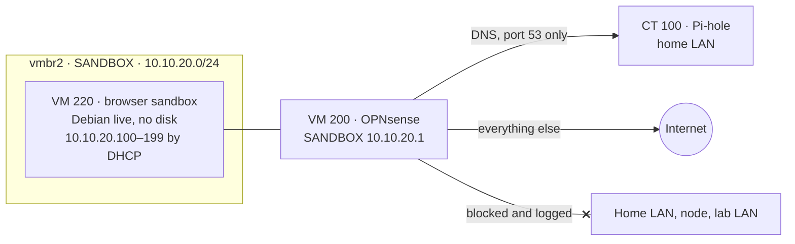

# Lab: Browser sandbox

## What it does

A disposable browser for opening websites I do not trust (aggressive ad networks,
redirect chains, fake download buttons) and measuring how much of that the home DNS
filter stops, without putting my devices or the home network at risk. It sits on its
own network behind the lab OPNsense ([Labs](09-labs.md)): it can reach the internet and
the home Pi-hole, and nothing else.

This is the *home mode*: the browser uses the same DNS filter as any device in the
house. The *Tor mode*, where neither the ISP nor the website can see both who I am and
what I visit, is [Tor isolation](12-tor-isolation.md).



## How it is built

**The network.** `vmbr2` is a Linux bridge with no physical port and no address on the
node. OPNsense's third card is the interface `opt1`, named SANDBOX, at `10.10.20.1/24`
with IPv6 off. Its DHCP server (Dnsmasq) hands out `10.10.20.100`–`.199` and gives the
Pi-hole as the only DNS server.

**Firewall rules on SANDBOX**, evaluated in this order:

| # | Action | Match | Why |
|---|---|---|---|
| 100 | Pass | TCP/UDP 53 to the Pi-hole | The filter being measured |
| 200 | Block and log | TCP/UDP 53 and 853 to anything else | No other resolver, no DNS over TLS |
| 300 | Block and log | `10.0.0.0/8`, `172.16.0.0/12`, `192.168.0.0/16` | Every private range: the home LAN, the lab LAN and OPNsense itself |
| 400 | Pass | Anything | The internet |

The rules use aliases (`pihole`, `dns_ports`, `private_networks`), so each one reads
like its description.

**VM 220 `browser-sandbox`**

- 2 cores, 4 GiB of RAM and **no disk**. It boots the Debian 13.7 live image with Xfce
  and Firefox. Proxmox downloaded the ISO itself and checked it against the SHA-256 in
  Debian's `SHA256SUMS`, fetched over HTTPS.
- One network card, on `vmbr2`. No QEMU guest agent, no shared clipboard, no shared
  folders.
- Whatever happens inside disappears when it powers off.

**Second layer: the Proxmox firewall on VM 220.** If OPNsense were ever misconfigured,
the VM's own firewall still holds:

| Direction | Rule |
|---|---|
| In | Drop everything (default policy) |
| Out | Accept DNS to the Pi-hole |
| Out | Drop and log DNS to anything else, and TCP 853 |
| Out | Drop and log `10.0.0.0/8`, `172.16.0.0/12` and `192.168.0.0/16` |
| Out | Accept the rest (default policy) |

The MAC filter is on, so the VM cannot send frames with another card's address. Rules
added through the API with a position came out in reverse order; they were reordered
before the firewall was switched on, because a drop for the home LAN's private range
ahead of the DNS rule would have cut the VM off from the Pi-hole.

**A name in the DNS logs.** OPNsense's WAN address has the local record
`opnsense-lab.lan` in Pi-hole and its own client entry in the default group, so every
query from the sandbox shows up under that name in the Query Log.

**Operation.** VM 220 does not start with the node and is excluded from the nightly
backups. A session:

1. Start VM 200 and wait a minute; start VM 220 and choose *Live system* in its console.
2. In Firefox, open `about:networking#dns` and check that *DoH Mode* is `0`. With
   Firefox's secure DNS on, the browser would skip the Pi-hole and the test would
   measure nothing. Every boot starts from scratch, so this is checked every time.
3. Watch from outside: Pi-hole's Query Log (client `opnsense-lab.lan`), OPNsense's
   *Firewall → Log Files → Live View*, and *VM 220 → Firewall → Log* in Proxmox.
4. Power off VM 220 (everything inside is gone) and VM 200.

No personal accounts are ever used inside, and nothing is copied between the sandbox
and my devices.

## Why this way

- **No disk instead of snapshots.** A live image cannot keep anything, so there is no
  clean state to restore and no rollback to forget.
- **Two independent layers.** The OPNsense rules and the VM's own firewall are
  configured separately; a mistake in one is caught by the other, and both log what
  they drop.
- **DNS pinned to the Pi-hole.** The point is to measure the home filter, so the
  browser must not reach another resolver. Plain DNS and DNS over TLS are blocked by
  port. DNS over HTTPS uses 443 like any website and cannot be blocked by port, which
  is why step 2 checks Firefox's setting by hand.
- **Its own network.** The lab LAN carries the domain, whose DNS goes through the
  domain controller and OPNsense; pinning DNS to the Pi-hole there would have broken
  it. That network blocks the private ranges too, with rules of its own
  ([Labs](09-labs.md)).

## Lesson learned: the Pi-hole saw the router instead of the sandbox

The first tests worked, but every query from the sandbox reached the Pi-hole as coming
from the home router, not from OPNsense. OPNsense had learned the Pi-hole as a DNS
server from the home router's DHCP on its WAN, and with that it installed a host route
to the Pi-hole *through the router*. The router forwarded the queries and they arrived
with its address as the source.

The fix was to untick *Allow DNS server list to be overridden by DHCP/PPP on WAN* and
reboot OPNsense; saving alone did not remove the route. Since then the Query Log shows
the sandbox as `opnsense-lab.lan`, and blocked domains can be tied to it.

## How to verify

On the node:

```sh
qm config 220 | grep -E 'net0|scsi|sata|virtio[0-9]|agent'   # only net0 on vmbr2 with firewall=1, agent 0, no disk
pvesh get /nodes/pve01/qemu/220/firewall/rules               # the DNS accept to the Pi-hole at position 0
```

From a client on `vmbr2` (CT 201 moved over for the test), every path was tried:

```text
IPv4 address                 10.10.20.192/24
DNS server                   <lan>.100
resolve debian.org           2a04:4e42:400::644
resolve api.vungle.com       ::                  (on the blocklist)
internet 1.1.1.1:443         OPEN
Pi-hole DNS tcp/53           OPEN
other DNS 1.1.1.1:53         BLOCKED
DNS over TLS 8.8.8.8:853     BLOCKED
router :80                   BLOCKED
Pi-hole web panel :80        BLOCKED
node web UI :8006            BLOCKED
home device :22000           BLOCKED
OPNsense WAN :443            BLOCKED
OPNsense SANDBOX :443        BLOCKED
OPNsense lab LAN :443        BLOCKED
```

OPNsense logged each blocked attempt with the description of the rule that stopped it.

Inside VM 220, `www.debian.org` loads, `api.vungle.com` fails with *Unable to connect*
and appears in the Query Log as blocked by the blocklist, and the router's web page
never answers while the VM's firewall log fills with drops to it.
