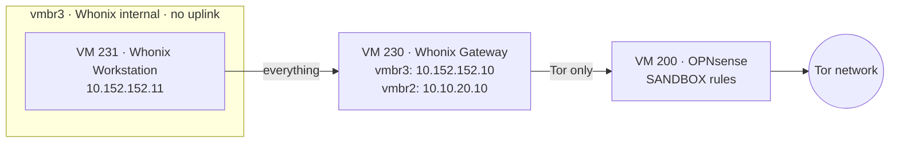

# Lab: Tor isolation with Whonix

## What it does

The second mode of the [browser sandbox](11-browser-sandbox.md): browsing where no
single party sees both who I am and what I open. My ISP sees that I use Tor but not the
sites; the sites see a Tor exit node, not my home address. No commercial VPN is
involved, because a VPN provider would see all of the traffic in one place.

It is built from Whonix, which splits the job between two VMs: a Gateway that only runs
Tor, and a Workstation where the browser lives. The Workstation has no route to
anything except the Gateway, so even if a page compromised it, it could not learn the
home IP address or reach the home network.



## How it is built

**The image.** Whonix 18.2.4.2 for KVM, LXQt edition (it ships Tor Browser). Before
use, the checksum file's OpenPGP signature was verified against the Whonix signing key,
fingerprint `916B 8D99 C38E AF5E 8ADC 7A2A 8D66 066A 2EEA CCDA`. Proxmox then downloaded
the image itself, checking the SHA-512 from that signed file, and the two `qcow2` disks
were imported straight into `local-lvm` with `import-from`, as thin volumes.

**`vmbr3`.** A Linux bridge with no physical port and no address on the node. Only two
things are attached to it: the Workstation and the Gateway's inner card.

**VM 230 `whonix-gateway`:** 1 core, 1 GiB.

- `eth0` on `vmbr2` (SANDBOX), static `10.10.20.10/24` with gateway `10.10.20.1`. Whonix
  ships the Gateway with `10.0.2.15`, meant for libvirt's NAT network, which does not
  exist here; the address was changed in
  `/etc/network/interfaces.d/30_non-qubes-whonix`, outside the DHCP range.
- `eth1` on `vmbr3`, `10.152.152.10/18`.
- Being on SANDBOX, it inherits OPNsense's sandbox rules: it can reach the internet and
  nothing private.

**VM 231 `whonix-workstation`:** 1 core, 2 GiB, a single card on `vmbr3`,
`10.152.152.11/18`. Its default route and its DNS server are the Gateway.

**Proxmox firewall, on both VMs:**

| VM | Direction | Rule |
|---|---|---|
| 231 | Out | Accept only to the Gateway (`10.152.152.10` and its IPv6 `fd19:c33d:88bc::10`); drop and log the rest |
| 231 | In | Drop and log everything |
| 231 | Spoofing | MAC filter and IP filter: it can only send from its own two addresses |
| 230 | In | Accept only from the Workstation, on the inner card; drop the rest |
| 230 | Out, on `vmbr2` | Drop and log `10.0.0.0/8`, `172.16.0.0/12` and `192.168.0.0/16` |

**Clean state.** Both VMs were fully updated over Tor, shut down, and snapshotted as
`clean-<date>`. They do not start with the node and are excluded from the nightly
backups.

**The Pi-hole is not involved.** DNS is resolved by Tor at the exit node; measuring the
home filter is what the browser sandbox is for.

**A session:**

1. Start VM 200 and wait a minute, then VM 230. When its `systemcheck` reports that Tor
   is connected, start VM 231.
2. Use Tor Browser on the Workstation. No personal accounts, ever.
3. Shut down both VMs and roll each back to `clean-<date>`. Alternatively, boot the
   Workstation in *LIVE Mode*, which keeps nothing.
4. Updates: boot into the *SYSMAINT* session (in Whonix 18 the everyday user has no
   sudo), upgrade, shut down and take a new clean snapshot.

## Why this way

- **Tor instead of a VPN.** A VPN moves the trust from the ISP to the VPN provider.
  Tor splits it: no relay knows both ends.
- **Two VMs instead of Tor Browser on one machine.** In Whonix, isolation does not
  depend on the browser behaving. The Workstation's only network is `vmbr3` and its only
  neighbor is the Gateway, so a leak of the real address is not a setting that can be
  wrong; there is no path for it.
- **Behind the sandbox, not on the home LAN.** The Gateway goes out through the same
  OPNsense rules as the browser sandbox, and its own firewall blocks private ranges
  again. If the Gateway were compromised, it still could not reach the home network.
- **Disposable.** Everything lives on the system disk and can be rebuilt from the signed
  image; the snapshots make each session start clean.

## Lesson learned: the Workstation froze with the standard display

With Proxmox's default display (`vga: std`) the Workstation's desktop froze a few
seconds after login: the clock stopped and neither keyboard nor mouse responded, and a
reset did not help. Whonix's own libvirt definition uses a VirtIO display; switching to
`vga: virtio` fixed it. The Gateway runs fine with `std`.

## What was tested

| Test | Result |
|---|---|
| Routes on the Workstation | Only `default via 10.152.152.10` and its own `/18`; DNS is `10.152.152.10` |
| `check.torproject.org` in Tor Browser | *Congratulations. This browser is configured to use Tor.* |
| `ipleak.net`, Tor mode | A Tor exit node's address in another country; no WebRTC leak |
| `ipleak.net`, home mode (VM 220) | The home ISP's address, for comparison |
| Capture on OPNsense's WAN, home mode | The page name in clear: in the DNS query to the Pi-hole and in the TLS SNI |
| Capture on OPNsense's WAN, Tor mode | Only encrypted connections to two Tor relays; no name in DNS or SNI |

The captures were taken with OPNsense's packet capture on the WAN while both modes
opened the same Wikipedia article. That is the difference the lab exists to show: in
home mode anyone on the path can read which site was visited; in Tor mode they cannot.

## How to verify

On the node:

```sh
ip -br addr show vmbr3                          # the bridge, no address
qm config 230 | grep -E '^net'                  # net0 on vmbr2, net1 on vmbr3, both firewall=1
qm config 231 | grep -E '^(net|vga|onboot)'     # net0 on vmbr3 only, vga virtio, onboot 0
qm listsnapshot 230; qm listsnapshot 231        # clean-<date> on both
pvesh get /nodes/pve01/qemu/231/firewall/rules  # only the two accepts to the Gateway
```

With VMs 200, 230 and 231 running, in a terminal on the Workstation:

```sh
curl -s https://check.torproject.org/api/ip     # {"IsTor":true, ...}
```
